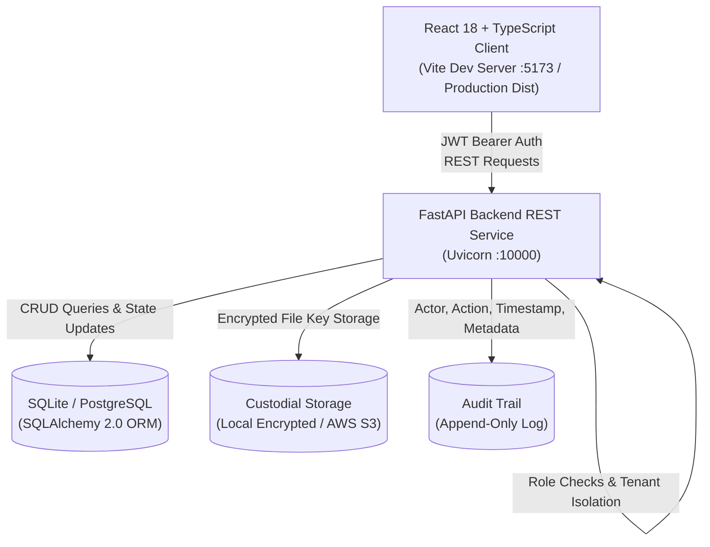
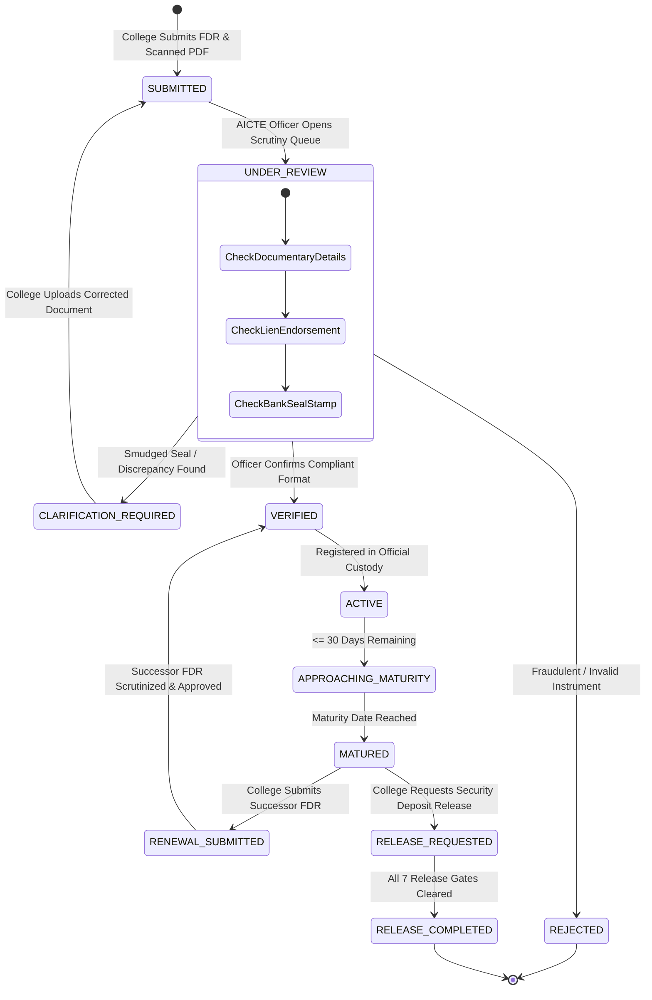
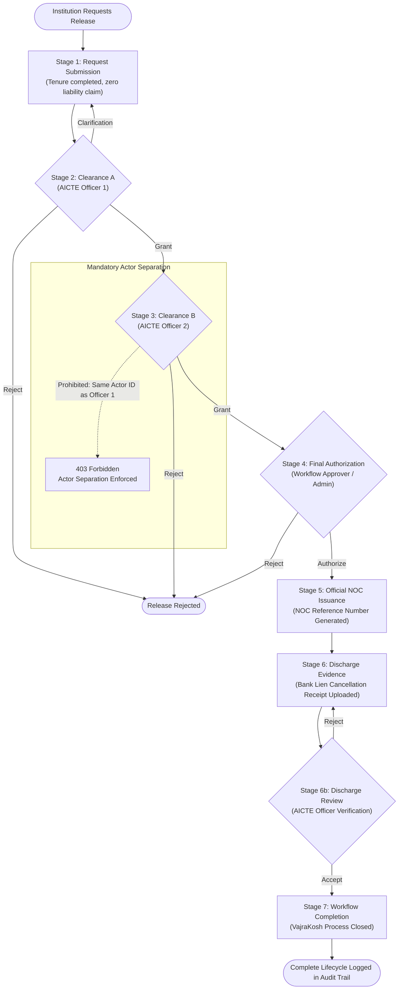
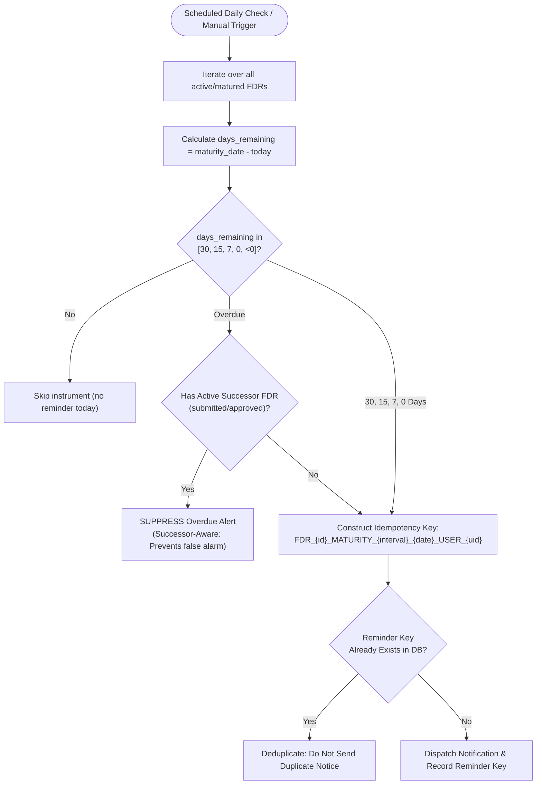
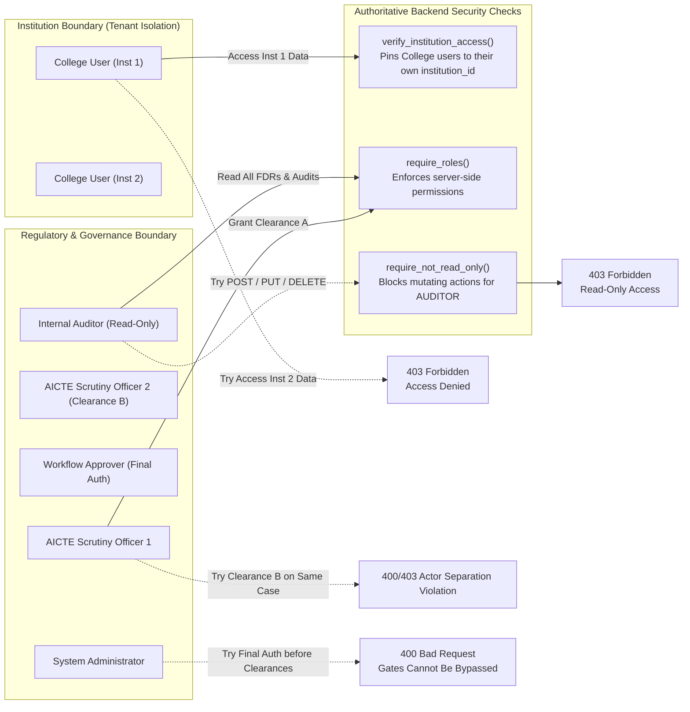

# VajraKosh — Prototype Flowcharts & State Machines

> **SIH 2026 Problem Statement ID: 26265**  
> *Editable Mermaid Flowcharts Matching Implemented and Tested Code*  
> **DISCLAIMER: PROTOTYPE · SYNTHETIC DATA · NO LIVE BANK CONNECTION · NO ACTUAL FUNDS TRANSFER**

---

## 1. High-Level System Architecture

---

## 2. FDR Lifecycle & Scrutiny State Machine

---

## 3. Seven-Stage Release & Refund Gatekeeper Pipeline

---

## 4. Successor-Aware Maturity & Idempotent Reminder Engine

---

## 5. Four-Role Matrix & Tenant Boundary Enforcement

